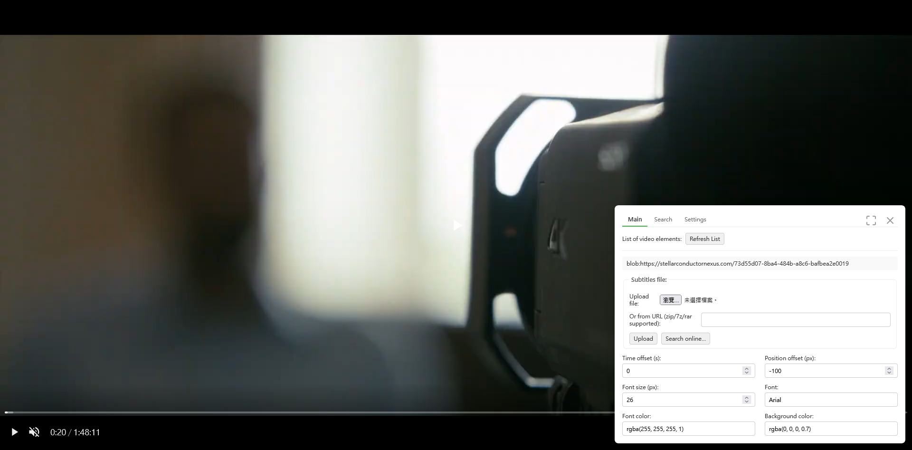
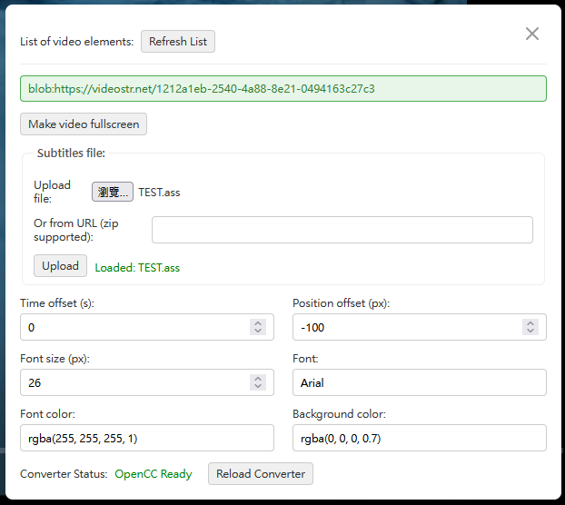

# Add Subtitles Extended

A simple yet powerful Firefox and Chrome browser extension that lets you add external subtitle files to any `<video>` element on a webpage.

## Screenshots

| Video Preview | Settings Panel |
| :---: | :---: |
|  |  |

| Video Controls |  |
| :---: | :---: |
|  |  |

## Project Overview
This project is a repaired and enhanced version based on the original add-subtitles extension. Major improvements include:
- Added support for ASS/SSA subtitle formats
- Automatic conversion from Simplified Chinese to Traditional Chinese
- Fixed fullscreen playback
- Improved appearance

## Features
- Supports SRT, VTT, and ASS/SSA subtitle formats
- Supports subtitles inside ZIP archives
- Automatic conversion from Simplified Chinese to Traditional Chinese
- Adjustable subtitle position, size, and color
- Supports fullscreen playback
- Keyboard shortcut controls

## Third-Party Library Notices

This extension uses the following third-party libraries. For complete information, please see [THIRD_PARTY_LIBRARIES.md](THIRD_PARTY_LIBRARIES.md):

### JSZip v3.3.0
- **Purpose**: Process subtitle files inside ZIP archives
- **Source**: [Official GitHub repository](https://github.com/Stuk/jszip)
- **License**: MIT License
- **Version**: 3.3.0 (stable version)

### OpenCC-JS v1.0.5
- **Purpose**: Convert Simplified Chinese to Traditional Chinese
- **Source**: [Official GitHub repository](https://github.com/nk2028/opencc-js)
- **License**: MIT License
- **Version**: 1.0.5 (stable version)

## Installation

1. Install it from the [Firefox Add-ons store](https://addons.mozilla.org/firefox/addon/add-subtitles-extended/) (recommended).
2. Alternatively, download the `.xpi` file and install it manually.
3. Run `npm install`, then run `npm run build` to create both browser packages.
4. In Chrome, open `chrome://extensions`, enable **Developer mode**, select **Load unpacked**, and choose `dist/chrome`.
5. In Firefox, open `about:debugging#/runtime/this-firefox`, select **Load Temporary Add-on**, and choose `dist/packages/add-subtitles-extended-firefox.zip`.

## Usage

1. Click the extension icon on a webpage containing a `<video>` element.
2. Select the video element to which you want to add subtitles.
3. Upload a subtitle file or enter the subtitle file URL.
4. Adjust the subtitle settings (optional).
5. Enjoy your video with subtitles!

### Videos inside iframes

If no video elements are found:

- **Firefox**: Press `Shift` and right-click the video, then select **This Frame** > **Open Frame in New Tab**.
- **Chrome**: Right-click the video, then select **Open This Frame in New Tab** from the extension's context menu.

After opening the frame in a new tab, click the extension icon again to detect the video.

## License

This project is licensed under the MIT License. For details, please see the [LICENSE](LICENSE) file.
